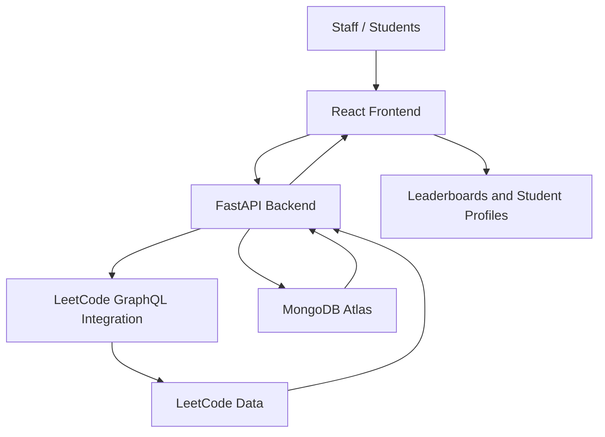

# LeetCode Performance Analysis

### A Data-Driven Platform for Tracking and Comparing Student Coding Performance

LeetCode Performance Analysis is a web application designed to simplify the process of monitoring and comparing coding progress across large groups of students. It helps staff and departments analyze student performance using LeetCode statistics, rankings, individual profiles, and contest ratings.

The project addresses the challenges of manually tracking the coding progress of 400+ students and makes performance analysis more organized and accessible.

## 🎯 Problem Statement

Manually monitoring the coding progress of hundreds of students is time-consuming and difficult to maintain. Comparing problem-solving activity, identifying top performers, and tracking individual improvement can require significant effort.

This project provides a centralized platform for analyzing student coding performance using available LeetCode statistics.

## ✨ Key Features

- **Student Leaderboards:** Rank students based on total problems solved, hard problems solved, and contest ratings.
- **Student Search:** Find students and access their performance information.
- **Individual Profiles:** View detailed statistics for individual students.
- **Contest Analysis:** Explore contest-related performance and rating information.
- **Recent Activity:** View recently solved problems when the required data is available.
- **Weekly Progress:** Track coding progress using available performance statistics.
- **Automated Data Retrieval:** Retrieve available LeetCode statistics through backend integrations.
- **Backend Reliability:** Handle transient failures, rate limits, and pending updates more safely.

## 🛠️ Tech Stack

| Technology | Purpose |
|---|---|
| React.js | Frontend user interface |
| JavaScript, HTML, CSS | Frontend development |
| Python | Backend development |
| FastAPI | Backend API framework |
| MongoDB Atlas | Database storage |
| LeetCode GraphQL integration | Retrieve available coding statistics |
| REST APIs | Communication between frontend and backend |

## 🏗️ System Architecture



### How It Works

1. A user opens the platform and selects a leaderboard or searches for a student.
2. The React frontend sends requests to the FastAPI backend.
3. The backend retrieves or processes available student statistics.
4. MongoDB stores application data where required.
5. The frontend displays rankings, profiles, and performance information.

## ⚙️ Backend Reliability Improvements

An important part of this project was improving backend reliability without unnecessarily changing existing functionality.

- **Bounded Retries:** Retry eligible failed operations within a defined limit.
- **Rate-Limit Handling:** Handle LeetCode request restrictions more carefully.
- **Pending Update Preservation:** Preserve pending work so updates can be retried instead of being lost.
- **Overlapping Job Prevention:** Reduce the risk of concurrent update jobs interfering with each other.
- **Automated Testing:** Ran 34 automated reliability tests successfully in the development environment.

These improvements focus on making existing features more dependable rather than introducing unnecessary architectural changes.

## 💡 What Makes This Project Useful?

- Reduces the manual effort involved in reviewing coding statistics across large student groups.
- Makes it easier to compare performance using multiple coding-related metrics.
- Helps students understand their progress through individual statistics.
- Combines frontend development, backend APIs, database integration, and reliability engineering.
- Demonstrates practical experience with API integration, data processing, ranking logic, and automated testing.

## 🚀 Getting Started

### Prerequisites

- Python and a compatible version supported by the project dependencies
- Node.js and npm
- MongoDB Atlas or a compatible MongoDB instance, if required
- Git

### 1. Clone the Repository

```bash
git clone https://github.com/DhanaJayan1918/Leetcode-Analysis-.git
cd Leetcode-Analysis-
```

### 2. Set Up the Backend

```bash
cd backend
python -m venv my_env
```

Activate the virtual environment.

**Windows:**

```bash
my_env\Scripts\activate
```

**Linux/macOS:**

```bash
source my_env/bin/activate
```

Install the dependencies:

```bash
pip install -r requirements.txt
```

Configure the required environment variables according to the backend configuration. Keep database credentials and API keys out of source control.

Start the backend:

```bash
uvicorn main:app --reload
```

The backend will typically be available at `http://127.0.0.1:8000`.

FastAPI documentation is typically available at `http://127.0.0.1:8000/docs`.

### 3. Set Up the Frontend

Open a new terminal and navigate to the frontend directory:

```bash
cd frontend
npm install
```

Configure the frontend API base URL to point to your backend, using the environment-variable name expected by the project.

Start the frontend:

```bash
npm run dev
```

Open the local URL displayed in the terminal.

> **Note:** Setup requirements may vary depending on the current repository configuration. Check the existing dependency files, scripts, and environment-variable definitions before running the application.

## 🧪 Testing

Run the backend reliability tests from the directory containing `test_reliability.py`:

```bash
python -m unittest test_reliability -v
```

The reliability test suite completed successfully with 34 tests in the tested development environment.

## 🔐 Privacy and Responsible Use

This platform works with coding statistics available through its integrations.

- Respect LeetCode's applicable terms and usage restrictions.
- Avoid collecting unnecessary personal information.
- Obtain appropriate permission before using student data for official departmental monitoring.
- Do not commit credentials, database connection strings, or private student information.
- Use sample or anonymized data in public demonstrations where appropriate.

## 🔮 Future Improvements

- More detailed historical performance trends.
- Additional leaderboard filters and comparison tools.
- Improved monitoring and reporting for data-update failures.
- Further automated testing and deployment checks.
- Enhanced privacy controls for student data.

## 👨‍💻 Author

**Dhana Jayan G**

B.Tech — Artificial Intelligence and Data Science

GitHub: [@DhanaJayan1918](https://github.com/DhanaJayan1918)


